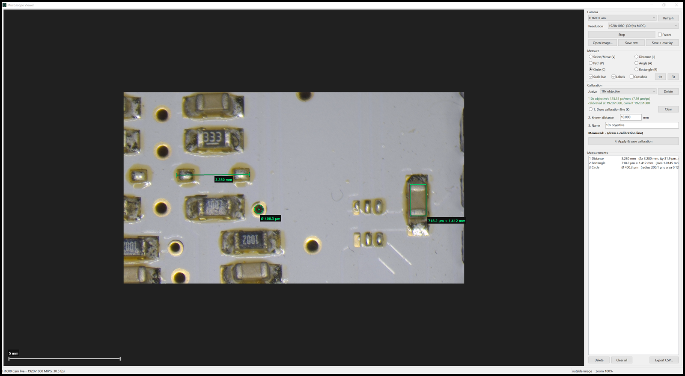

# Microscope Viewer

Live view and measurement tool for USB (UVC) microscope cameras on Windows.
Put a ruler under the microscope once to calibrate, then measure distances, angles,
circles and areas directly on the live image, in millimetres or micrometres.



The project comes in two versions with the same features:

| Version | What you need | Best for |
|---|---|---|
| **Go** (`go/`) | Nothing, a single portable `.exe` (about 4 MB) | Everyday use, copying to other PCs |
| **Python** (`python/`) | Python 3.9+ with OpenCV, NumPy and Pillow | Hacking on it; also runs on Linux/macOS (tested on Windows) |

## Features

- **Live camera view** from any UVC/USB microscope or webcam, with camera and resolution selection.
  "Maximum available" picks the camera's highest resolution automatically.
- **Calibration with a ruler.** Mark two ruler lines a known distance apart (for example 10 mm).
  Save one calibration per objective or zoom level and switch between them.
- **Measuring tools:** distance, path (polyline), angle, circle (diameter, radius, area)
  and rectangle (width, height, area).
- **Edit measurements:** select, move and fine-tune endpoints by dragging.
- **Zoom and pan** for sub-pixel accurate placement (mouse wheel up to 6400 %).
- **Overlays:** scale bar, crosshair at the image centre, measurement labels.
- **Freeze** the live image, or **open a saved image** to measure it later.
- **Save** the raw image or the image with measurements drawn on it (PNG, JPEG, TIFF).
- **Export** all measurements to CSV (opens in Excel).

## Quick start

### Go version (Windows)

1. Download `MicroscopeViewer.exe` from the [Releases](../../releases) page, or build it yourself (see below).
2. Plug in the microscope camera and double-click the `.exe`.

No installation needed. Calibrations are saved in `calibrations.json` next to the `.exe`;
copy both files together to move the app to another PC.

### Python version

```bash
cd python
pip install -r requirements.txt
python microscope_viewer.py
```

On Windows you can also double-click `python/run.bat`.

## How to calibrate

You need a ruler or stage micrometer under the microscope.

1. Place the ruler under the microscope and focus it sharply.
2. Choose **1. Draw calibration line (K)** and click on two ruler marks, for example 10 mm apart.
   Zoom in with the mouse wheel and drag the line's ends onto the centre of each mark for best accuracy.
3. Enter the **known distance** in millimetres (default 10.000).
4. Give the calibration a **name** (for example "10x objective") and click **Apply & save calibration**.

Check the result by measuring another span on the ruler with the Distance tool.

A calibration is valid for one optical setup (objective and zoom). If you change the camera
resolution, the calibration is scaled automatically. If the image aspect ratio changes, the app
warns you to recalibrate, because the picture is then cropped differently.

## Using the tools

| Tool | Key | How to use |
|---|---|---|
| Select / Move | `V` | Click a measurement to select it, drag it or its handles. Drag empty space to pan. |
| Distance | `L` | Click two points, or drag. |
| Path | `P` | Click points; double-click or right-click to finish. |
| Angle | `A` | Click the end of the first arm, the vertex, then the end of the second arm. |
| Circle | `C` | Click the centre, then a point on the edge. |
| Rectangle | `R` | Click two opposite corners. |
| Calibration line | `K` | Click two ruler marks a known distance apart. |

**Other controls:** mouse wheel zooms at the cursor, middle mouse button pans,
`Esc` cancels the shape being drawn, `Delete` removes the selected measurement,
**Fit** and **1:1** reset the zoom.

## Building from source

### Go

Requires [Go](https://go.dev/dl/) 1.27 or newer. No C compiler is needed: the app talks to
Windows directly (Win32 for the window, Media Foundation for the camera).

```bash
cd go
go build -trimpath -ldflags "-H windowsgui -s -w" -o ../dist/MicroscopeViewer.exe .
```

or run `go/build.bat`. The icon, version info and Windows manifest are in
`go/rsrc_windows_amd64.syso`, generated from `go/winres/winres.json` with
[go-winres](https://github.com/tc-hib/go-winres):

```bash
go run github.com/tc-hib/go-winres@latest make --arch amd64
```

### Python

The Python version is one file, `python/microscope_viewer.py`, using Tkinter for the
window and OpenCV for the camera.

## Project layout

```
go/        Go version (Windows, single .exe)
  app.go       main window, panel, calibration and file handling
  viewer.go    zoomable image view and mouse tools
  draw.go      measurement overlay drawing
  shapes.go    measurement geometry and formatting
  capture.go   camera capture through Media Foundation
  calib.go     calibration file (calibrations.json)
  win32.go     Windows API bindings
python/    Python version (Tkinter + OpenCV)
docs/      screenshots
```

## Accuracy notes

- Results are only as good as the calibration. Calibrate over a long distance
  (for example 10 mm rather than 1 mm) and zoom in when placing the ends.
- Lens distortion is not corrected. Measurements near the centre of the image are the most accurate.
- Measured values are shown in µm below 1 mm, otherwise in mm.

## License

[MIT](LICENSE). Free to use, modify and share, including commercially.
